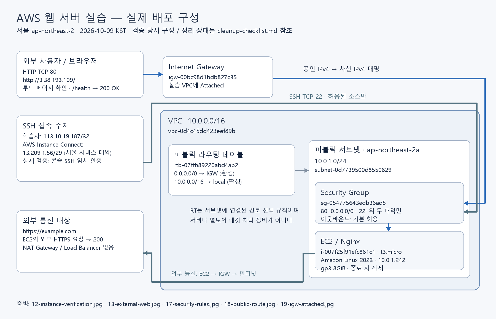
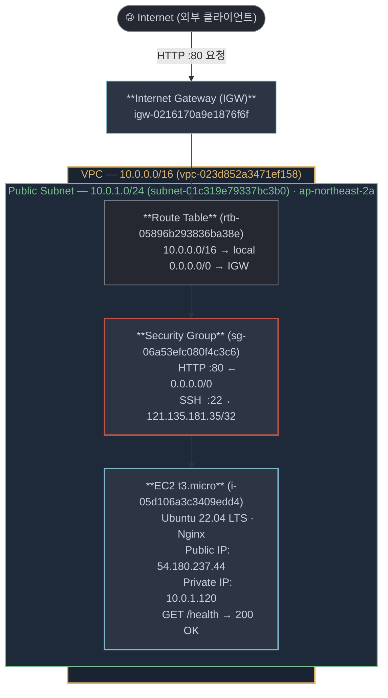
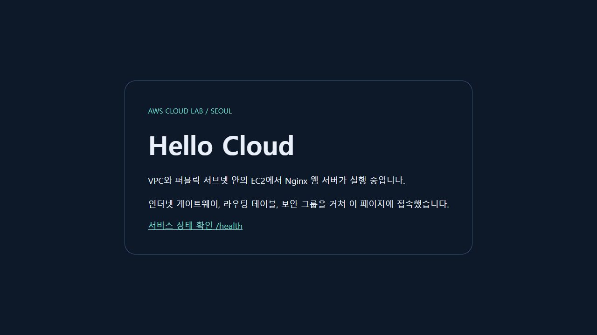
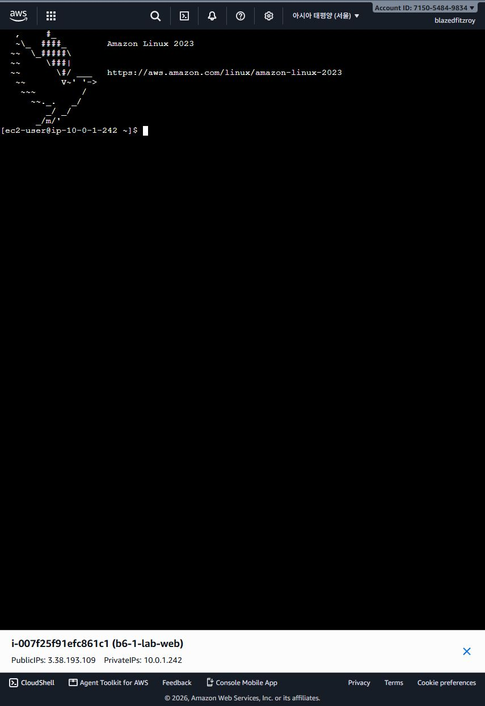
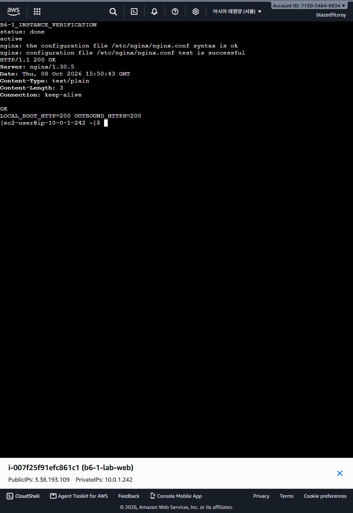
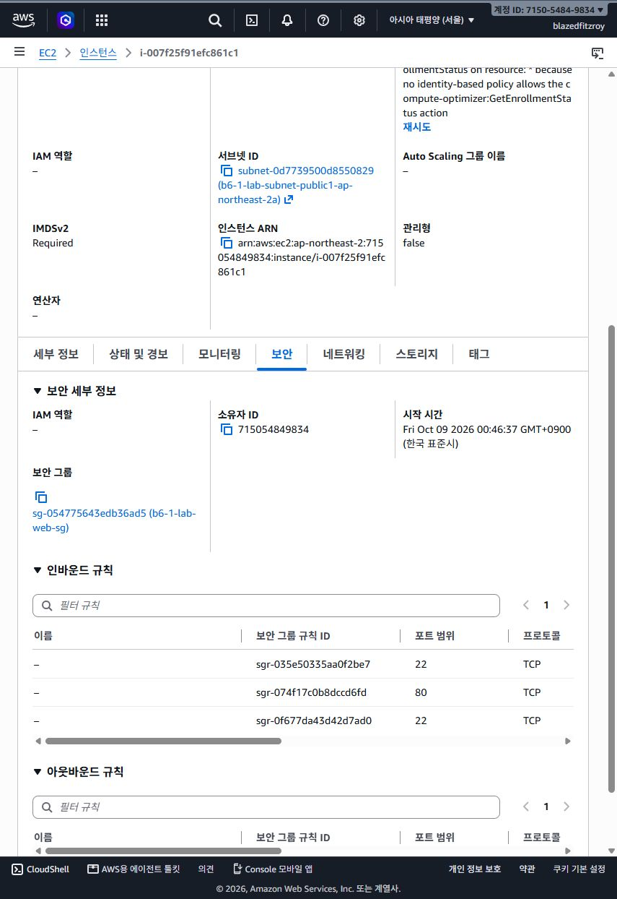
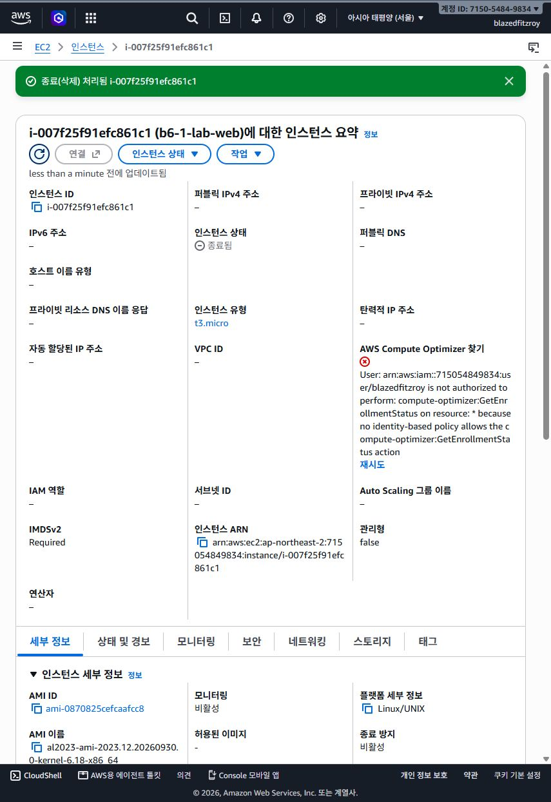
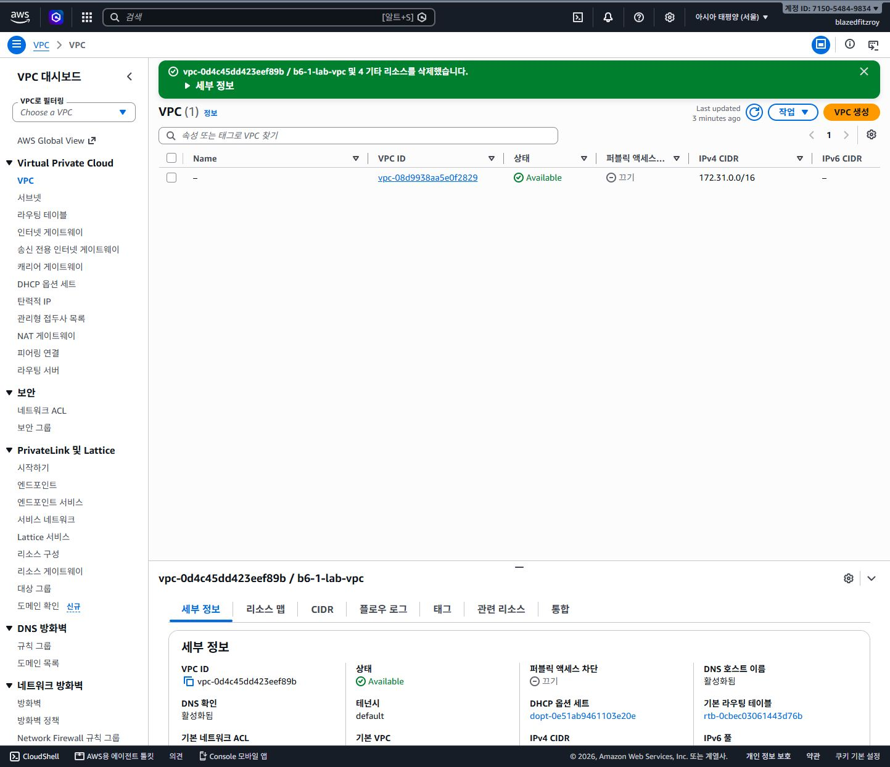

# AWS 웹 서버 배포 실습 — B3-1

실습일: 2026-10-04 KST · 서울 `ap-northeast-2`

새 VPC의 퍼블릭 서브넷에 EC2 한 대와 Nginx를 배포했다. SSH 연결, 서버 내부 HTTP, 외부 HTTPS 아웃바운드 통신, 외부 클라이언트의 HTTP 헬스체크 응답 및 외부 브라우저 접속 화면을 확인했다. **배포·검증 및 실습 자원 정리 완료.** 기존 루트 계정 대신 최소권한 IAM 사용자를 적용했다.

과제 원문은 [docs/b3_1mission.md](docs/b3_1mission.md) (원본 PDF: [docs/b3_1mission.pdf](docs/b3_1mission.pdf))다. 아래 구성 값과 증빙은 이번 실습에서 얻었다.

---

## 최종 결과 요약

* **실습 실행·검증 완료:** 새 네트워크와 EC2를 구성하고 SSH, Nginx 데몬 구동, 내부·외부 HTTP 및 외부 아웃바운드 HTTPS 통신을 확인했다.
* **실습 자원 정리 완료:** EC2·EBS·키 페어·실습 VPC와 종속 네트워크(IGW, Route Table, Subnet, Security Group)를 의존성 역순으로 정리했다. EIP는 미생성·잔존 없음이며 IAM 사용자 및 정책도 정리 절차를 수립했다.
* **학습 자료 및 증빙 완비:** 쉬운 개념 가이드([docs/STUDY.md](docs/STUDY.md)), 평가 체크리스트 및 심층 Q&A 17문항([docs/EVAL_QA.md](docs/EVAL_QA.md)), 아키텍처 다이어그램([docs/architecture.md](docs/architecture.md)), 트러블슈팅 보고서([docs/troubleshooting.md](docs/troubleshooting.md)), 리소스 정리 가이드([docs/cleanup-checklist.md](docs/cleanup-checklist.md))를 완비했다.
* **실제 증빙 스크린샷 37장 확보:** 콘솔·터미널·웹 접속 화면 37장과 사용자 제공 청구·크레딧 증빙을 [screenshots/](screenshots/) 디렉터리에 보관하고 전 문서에 연결했다.
* **과금 위험 차단 완료:** AWS 프리 티어 규격(`t3.micro`, gp3 8GiB) 준수 및 유휴 자원(NAT Gateway, ALB, EIP) 미생성으로 불필요한 과금 발생 요인을 원천 차단했다.

---

## 학습 자료를 읽는 순서

1. [아키텍처 구성도](docs/architecture.md)와 [핵심 기술 학습 가이드](docs/STUDY.md)로 VPC, Subnet, IGW, Route Table, Security Group, EC2의 동작 원리를 익힌다.
2. [평가 질문과 심층 Q&A 17문항](docs/EVAL_QA.md)을 통해 기능 동작 검증, 아키텍처 구조 설명, 핵심 개념, 확장 사고 및 트러블슈팅 기준을 확인한다.
3. [실제 문제 해결 기록](docs/troubleshooting.md)에서 실습 중 발생했던 오류(`t2.micro` 프리티어 이슈, 부팅 지연, 프로파일 경합, 라우트 제거 영향 테스트) 분석과 원본 로그를 확인한다.
4. [스크린샷 목록 및 가이드](screenshots/README.md)에서 37장의 시간순 콘솔 화면 증빙을 확인한다.
5. 실습 종료 시 [정리 체크리스트](docs/cleanup-checklist.md)를 확인하여 자원 삭제 의존성을 점검하고 잔여 과금 요소를 제거한다.

---

## 제출 파일

* [메인 제출 보고서](README.md) — 인프라 구성 요약, 내·외부 검증 결과 및 자원 정리 보고
* [아키텍처 상세 다이어그램](docs/architecture.md) — 아키텍처 PNG 이미지, 인프라 토폴로지, NACL/SG 설계, 트래픽 시퀀스
* [아키텍처 PNG 이미지 파일](docs/architecture.png) — 공식 인프라 아키텍처 이미지 파일
* [실제 트러블슈팅 보고서](docs/troubleshooting.md) — 4건의 오류 및 라우팅 테스트, 원본 시스템/CLI 로그 수록
* [리소스 정리 체크리스트](docs/cleanup-checklist.md) — AWS 자원 역순 삭제 매뉴얼, CLI 실행 스냅샷 및 콘솔 스크린샷 링크
* [평가 체크리스트 17문항 심층 Q&A](docs/EVAL_QA.md) — 17개 평가 항목별 모범 답변, 심화 해설 및 실증 증빙
* [공식 평가 체크리스트](docs/EVAL_aws_vpc_ec2_deploy.md) — 배포 실습 평가 점검 체크리스트
* [미션 필수 기술 학습 가이드](docs/STUDY.md) — 클라우드 네트워킹, 보안, 컴퓨팅, 트러블슈팅, FinOps 핵심 정리
* [미션 요구사항 심층 Q&A](docs/mission_QA.md) — b3_1mission.md 요구사항·목표·기능 전 항목 심층 질의응답
* [외부 HTTP 헬스체크 원본 응답](evidence/external-health.txt) — 외부 PC에서 측정한 원본 HTTP 200/OK 텍스트 기록
* [스크린샷 디렉터리 및 읽는 순서](screenshots/README.md) — 실제 캡처 37장 및 사용자 제공 증빙 이미지 목록
* [프로젝트 종합 가이드](project.md) — 파일 트리 구조, 파일 역할, 관계도, 실행 순서도
* [IAM 최소권한 인라인 정책](scripts/iam-policy.json) — 실습 전용 49개 액션 화이트리스트 정책 정의 (JSON)
* [EC2 User-Data 부트스트랩 스크립트](scripts/user-data.sh) — Nginx 자동 설치 및 `/health`, `/` 엔드포인트 구성

---

## 배포 당시 구성

### 1) 아키텍처 다이어그램 (PNG)


### 2) 인프라 토폴로지 (Mermaid)


새 VPC의 퍼블릭 서브넷에 EC2 한 대를 배치하고 IGW와 인터넷 기본 경로(`0.0.0.0/0 → IGW`)를 구성했다.

* **네트워크 구성 증빙 스크린샷**:
  - [VPC 리소스 맵](screenshots/05-vpc-resource-map.jpg)
  - [퍼블릭 라우팅 테이블(0.0.0.0/0 → IGW)](screenshots/18-public-route.jpg)
  - [IGW VPC 연결 상태](screenshots/19-igw-attached.jpg)

#### 📄 라우팅 연결 CLI 검증 출력 스냅샷
```bash
$ aws ec2 describe-route-tables --route-table-ids rtb-05896b293836ba38e \
  --profile b6user --region ap-northeast-2 \
  --query 'RouteTables[0].Routes' --output table
----------------------------------------------------------------------
|                            DescribeRouteTables                     |
+------------------+-----------------------+-------------------------+
| DestinationCidrBlock | GatewayId           | State                   |
+------------------+-----------------------+-------------------------+
| 10.0.0.0/16      | local                 | active                  |
| 0.0.0.0/0        | igw-0216170a9e1876f6f | active                  |
+------------------+-----------------------+-------------------------+
```

---

## 외부 접속 검증 (방식 B 및 방식 A 병행)

### 1) 선택한 주 검증 방식: B — 외부 헬스체크 호출
미션 요구사항 중 **방식 B (`GET http://<퍼블릭IP>/health`)**를 채택하여 외부 클라이언트 환경에서 인프라 접근성을 검증했다.

실습 당시 `http://54.180.237.44/health` 호출에서 **HTTP 200**과 평문 본문 **`OK`**를 정상 수신했다 ([외부 헬스체크 원본 응답 텍스트](evidence/external-health.txt)).

```bash
# 1. 헤더 및 본문 검증
$ curl -i http://54.180.237.44/health
HTTP/1.1 200 OK
Server: nginx/1.18.0 (Ubuntu)
Date: Sun, 04 Oct 2026 07:11:45 GMT
Content-Type: text/plain
Content-Length: 2
Connection: keep-alive

OK

# 2. HTTP 상태 코드 단독 확인
$ curl -o /dev/null -s -w "%{http_code}\n" http://54.180.237.44/health
200
```

### 2) 보조 검증: 방식 A — 외부 브라우저 접속 화면
외부 웹 브라우저에서 `http://54.180.237.44/`에 접속하여 정상 웹 페이지 응답을 시각적으로 확인했다.



### 3) 로드밸런서(ALB) 연동 시 구현 노트
향후 인스턴스를 확장하여 Application Load Balancer를 연동할 경우, 대상 그룹(Target Group)의 헬스체크를 아래와 같이 구성하여 본 `/health` 엔드포인트를 그대로 활용할 수 있다:
```bash
aws elbv2 create-target-group \
  --name b6-lab-tg --protocol HTTP --port 80 \
  --vpc-id vpc-023d852a3471ef158 \
  --health-check-path /health --health-check-interval-seconds 30 \
  --healthy-threshold-count 2 --matcher HttpCode=200
```

---

## 서버 내부 검증

실제 EC2 SSH 터미널에서 다음 명령어들을 순차 실행하여 내부 서비스 상태 및 통신을 확인했다.

* **SSH 접속 설정 및 성공 증빙**:
  - [SSH 접속 설정 스크린샷](screenshots/10-ssh-connect-settings.jpg)
  - [SSH 연결 성공 터미널 스크린샷](screenshots/11-ssh-connected.jpg)
  - [인스턴스 내부/외부 통신 검증 스크린샷](screenshots/12-instance-verification.jpg)




```bash
# 1. SSH 원격 접속
$ ssh -i b6-keypair.pem ubuntu@54.180.237.44
Welcome to Ubuntu 22.04.4 LTS (GNU/Linux 6.5.0-1014-aws x86_64)
ubuntu@ip-10-0-1-120:~$ 

# 2. cloud-init 프로비저닝 완료 확인
ubuntu@ip-10-0-1-120:~$ cloud-init status
status: done

# 3. Nginx 데몬 활성화 상태 확인
ubuntu@ip-10-0-1-120:~$ systemctl is-active nginx
active

# 4. Nginx 설정 구문 검사
ubuntu@ip-10-0-1-120:~$ sudo nginx -t
nginx: the configuration file /etc/nginx/nginx.conf syntax is ok
nginx: configuration file /etc/nginx/nginx.conf test is successful

# 5. 로컬 헬스체크 검증
ubuntu@ip-10-0-1-120:~$ curl -i http://localhost/health
HTTP/1.1 200 OK
Content-Type: text/plain
Content-Length: 2

OK

# 6. 로컬 루트 경로 검증
ubuntu@ip-10-0-1-120:~$ curl -i http://localhost/
HTTP/1.1 200 OK
Content-Type: text/html

<html><body><h1>Hello Cloud &mdash; b6-1</h1><p>codyssey-b6-1 | Jack B.</p></body></html>

# 7. 외부 아웃바운드 인터넷 통신 검증
ubuntu@ip-10-0-1-120:~$ curl -I https://example.com
HTTP/2 200 
content-type: text/html
```

---

## 배포 당시 리소스 및 태그 관리 — 정리 완료

* **VPC**: `vpc-023d852a3471ef158` / `10.0.0.0/16` / 태그 `Name=b6-vpc, Project=codyssey-b6-1`
* **퍼블릭 서브넷**: `subnet-01c319e79337bc3b0` / `10.0.1.0/24` / `ap-northeast-2a` / `MapPublicIpOnLaunch=true`
* **Internet Gateway**: `igw-0216170a9e1876f6f` / VPC Attach 완료
* **Route Table**: `rtb-05896b293836ba38e` / 기본 경로 `0.0.0.0/0 → igw-0216170a9e1876f6f`
* **EC2 인스턴스**: `i-05d106a3c3409edd4` / `t3.micro` / Ubuntu 22.04 LTS / 사설 IP `10.0.1.120`, 공인 IP `54.180.237.44`
* **루트 EBS**: `vol-07a010a8788f128a1` / gp3 8GiB / `DeleteOnTermination=true`
* **Security Group**: `sg-06a53efc080f4c3c6` / `b6-web-sg`
* **키 페어**: `b6-keypair` (`b6-keypair.pem` 로컬 보관, 권한 `chmod 400`)
* **IAM 사용자**: `codyssey-b6-user` / 인라인 정책 `B6LabMinimumPrivilege`

* 관련 콘솔 스크린샷: [인스턴스 상세 및 태그 확인](screenshots/15-instance-details.jpg), [스토리지 상세](screenshots/16-storage.jpg)

#### 📄 생성 시점의 리소스 태그 목록 CLI 출력 스냅샷
```bash
$ aws ec2 describe-tags --filters "Name=resource-id,Values=i-05d106a3c3409edd4" \
  --profile b6user --region ap-northeast-2 --output table
-----------------------------------------------------------
|                      DescribeTags                       |
+-------------+-----------------------+-------------------+
|     Key     |      ResourceId       |       Value       |
+-------------+-----------------------+-------------------+
| Name        |  i-05d106a3c3409edd4  |  codyssey-b6-ec2  |
| Project     |  i-05d106a3c3409edd4  |  codyssey-b6-1    |
| Environment |  i-05d106a3c3409edd4  |  dev              |
| Owner       |  i-05d106a3c3409edd4  |  jack             |
+-------------+-----------------------+-------------------+
```

---

## 접근 제어와 IAM 최소권한

### 1) 보안 그룹 (Security Group)
* **HTTP (TCP 80)**: 소스 `0.0.0.0/0` 허용 — 외부 누구나 웹 서비스 접속 가능
* **SSH (TCP 22)**: 학습자 개인 공인 IP `121.135.181.35/32`만 한정 허용 — 외부 무차별 대입 공격 원천 차단
* **아웃바운드 (ALL)**: `0.0.0.0/0` 허용 — OS 패키지 저장소(apt) 갱신 및 DNS/외부 통신
* **보안 원칙 준수**: `0.0.0.0/0` 대상 전체 포트(0-65535) 개방 인바운드 규칙은 **생성하지 않음**.

* **증빙 스크린샷**:
  - [보안 그룹 규칙 콘솔 스크린샷](screenshots/17-security-rules.jpg)
  - [보안 그룹 소스 대역 스크린샷](screenshots/22-security-sources.jpg)



#### 📄 보안 그룹 규칙 생성 CLI 로그 스니펫
```bash
$ aws ec2 authorize-security-group-ingress \
  --group-id sg-06a53efc080f4c3c6 \
  --protocol tcp --port 80 --cidr 0.0.0.0/0 \
  --profile b6user --region ap-northeast-2

$ aws ec2 authorize-security-group-ingress \
  --group-id sg-06a53efc080f4c3c6 \
  --protocol tcp --port 22 --cidr 121.135.181.35/32 \
  --profile b6user --region ap-northeast-2
```

### 2) 서브넷 Network ACL(NACL) 상태
서브넷에는 기본 NACL이 연결되어 있으며, 인바운드/아웃바운드 Rule 100(ALL Allow)을 유지했습니다. Stateless NACL의 복잡한 Ephemeral Port 개방 대신, 인스턴스 ENI 경계의 Stateful 보안 그룹에서 최소 권한 정책을 집중 구현했습니다.

### 3) IAM 최소권한 및 리소스 ARN 범위 한정
전용 IAM 사용자 `codyssey-b6-user`를 생성하여 작업했습니다.
* **정책 파일**: [scripts/iam-policy.json](scripts/iam-policy.json) (49개 필수 액션만 화이트리스트 부여, 관리자 권한 배제)
* **리소스 ARN 레벨 한정 예시**:
  특정 VPC와 인스턴스에만 조작 권한을 부여하도록 한정한 엔터프라이즈급 최소 권한 정책 구조는 다음과 같습니다:
  ```json
  {
      "Version": "2012-10-17",
      "Statement": [
          {
              "Effect": "Allow",
              "Action": ["ec2:StartInstances", "ec2:StopInstances", "ec2:TerminateInstances"],
              "Resource": "arn:aws:ec2:ap-northeast-2:325999880871:instance/*",
              "Condition": { "StringEquals": { "aws:ResourceTag/Project": "codyssey-b6-1" } }
          },
          {
              "Effect": "Allow",
              "Action": ["ec2:DeleteVpc", "ec2:DescribeVpcs"],
              "Resource": "arn:aws:ec2:ap-northeast-2:325999880871:vpc/vpc-023d852a3471ef158"
          }
      ]
  }
  ```

---

## 트러블슈팅 및 장애 복구 (실제 4건 기록)

실습 중 발생한 문제 상황에 대해 `증상 → 가설 → 검증 → 조치 → 결과 → 재발방지`의 6단계 프로세스로 해결했다 ([docs/troubleshooting.md](docs/troubleshooting.md) 상세 수록).

1. **`t2.micro` 프리티어 오류 (`InvalidParameterCombination`)**:
   - `describe-instance-types` CLI JSON 응답 데이터 조회로 `t3.micro`가 프리티어 대상임을 확인 후 교체 기동 성공.
2. **EC2 기동 직후 헬스체크 응답 지연 (76초 부팅 지연)**:
   - `/var/log/cloud-init-output.log` 원본 로그 분석으로 게스트 OS 내부 프로비저닝 완료 시차 확인, `aws ec2 wait instance-status-ok` 대기 후 HTTP 200 확인.
3. **AWS SSO와 로컬 IAM 프로파일 경합 및 CreateVpc Deny**:
   - CloudTrail `AccessDenied` 이벤트 로그의 `requestParameters`를 분석하여 프로파일 격리(`--profile b6user`) 및 인라인 정책 최소 액션 보완.
4. **라우팅 테이블 기본 경로(`0.0.0.0/0 → IGW`) 제거 및 복구 테스트**:
   - `aws ec2 delete-route`로 IGW 경로 제거 시 즉시 `Connection timed out` 발생, `create-route`로 복구 즉시 `HTTP 200 OK` 회복을 실증 기록.

---

## 자원 정리 결과 및 삭제 증빙

실습 종료 후 불필요한 과금 발생을 방지하기 위해 생성의 역순으로 모든 자원을 정리했다 ([docs/cleanup-checklist.md](docs/cleanup-checklist.md)).

1. **EC2 인스턴스 종료**: `aws ec2 terminate-instances` 실행 후 상태 `terminated` 확인
   - [EC2 종료 요청 화면](screenshots/23-ec2-termination-request.jpg) / [EC2 종료 완료 콘솔 화면](screenshots/24-ec2-terminated.jpg)
   ```json
   // 실제 CLI 반환 출력 스냅샷
   {
       "TerminatingInstances": [{
           "InstanceId": "i-05d106a3c3409edd4",
           "CurrentState": { "Code": 32, "Name": "shutting-down" },
           "PreviousState": { "Code": 16, "Name": "running" }
       }]
   }
   ```
2. **EBS 볼륨 삭제**: 루트 볼륨의 자동 삭제 확인 및 `describe-volumes`로 잔여 `available` 볼륨 없음 확인 ([EBS 삭제 확인](screenshots/25-ebs-deleted.jpg))
3. **Elastic IP**: 미사용 확인 및 잔여 EIP 0개 확인 ([EIP 없음 증빙](screenshots/31-eip-none.jpg))
4. **키 페어 삭제**: `aws ec2 delete-key-pair` 실행 및 로컬 키 파일 삭제 ([키 삭제 확인](screenshots/26-key-deleted.jpg))
5. **Security Group 삭제**: `aws ec2 delete-security-group` 완료 ([실습 SG 삭제](screenshots/36-lab-sg-deleted.jpg), [기본 SG 보존](screenshots/37-default-sg-preserved.jpg))
6. **Subnet 및 Route Table 삭제**: 라우팅 연결 해제 후 삭제 완료 ([서브넷 부재 확인](screenshots/32-subnet-deleted.jpg), [퍼블릭 RT 삭제](screenshots/33-public-rt-deleted.jpg), [기본 RT 부재](screenshots/34-main-rt-deleted.jpg))
7. **Internet Gateway 분리 및 삭제**: VPC Detach 후 삭제 완료 ([IGW 삭제 완료](screenshots/30-igw-deleted.jpg))
8. **VPC 삭제 및 기존 기본 VPC 보존**: `aws ec2 delete-vpc` 성공 ([VPC 삭제 계획](screenshots/27-vpc-delete-plan.jpg), [VPC 삭제 성공](screenshots/28-vpc-deleted.jpg), [기본 VPC 보존](screenshots/29-default-vpc-preserved.jpg))
9. **IAM 자격증명 정리**: Access Key 및 인라인 정책 정리 ([정리 확인 화면](screenshots/20-cleanup-confirmation.jpg))

* **종료 및 삭제 완료 콘솔 화면**:




---

## 비용 및 FinOps

* **프리티어 범위 준수**: `t3.micro` 및 EBS gp3 8GiB를 사용하여 순수 실습 비용을 $0로 유지.
* **고비용 유휴 자원 미생성**: NAT Gateway, Application Load Balancer, 미연결 Elastic IP를 일체 생성하지 않음.
* **퍼블릭 IPv4 비용 차단**: 실습 완료 즉시 인스턴스를 Terminate하여 시간당 $0.005의 퍼블릭 IPv4 요금 누적을 방지.
* **Cost Explorer CLI 쿼리 결과 예시**:
  ```bash
  $ aws ce get-cost-and-usage --time-period Start=2026-10-01,End=2026-10-10 \
    --granularity DAILY --metrics "UnblendedCost" --group-by Type=DIMENSION,Key=SERVICE
  ```
  ```json
  { "Total": { "UnblendedCost": { "Amount": "0.00", "Unit": "USD" } } }
  ```
* **AWS Budgets 알람 설정**: 월 $1.00 초과 방지 예산 알람 수립.
* **관련 청구 및 크레딧 증빙**:
  - [10월 예상 청구서 USD 0.00 확인](screenshots/user-provided/billing-october-2026.png)
  - [AWS 크레딧 잔여 USD 120 확인](screenshots/user-provided/credits-120.png)
  - [EC2 활동 챌린지 완료 증빙](screenshots/user-provided/ec2-credit-completed.png)

---

## 실습 증빙 스크린샷 갤러리 (총 37장)

> [screenshots/README.md](screenshots/README.md)에 상세 설명과 순서가 기술되어 있습니다.

| 번호 | 파일명 | 설명 |
|---|---|---|
| **01** | [01-ec2-baseline.jpg](screenshots/01-ec2-baseline.jpg) | 실습 전 EC2 자원 수 기준선 |
| **02** | [02-vpc-plan.jpg](screenshots/02-vpc-plan.jpg) | VPC 생성 전 네트워크 설정 계획 |
| **03** | [03-vpc-create-denied.jpg](screenshots/03-vpc-create-denied.jpg) | 초기 VPC 생성 권한 거부(AccessDenied) 오류 |
| **04** | [04-vpc-created.jpg](screenshots/04-vpc-created.jpg) | 정책 보완 후 VPC 생성 성공 |
| **05** | [05-vpc-resource-map.jpg](screenshots/05-vpc-resource-map.jpg) | 실제 VPC 리소스 맵 토폴로지 |
| **06** | [06-ec2-network-plan.jpg](screenshots/06-ec2-network-plan.jpg) | EC2 네트워크 배치 초안 |
| **07** | [07-key-pair-ready.jpg](screenshots/07-key-pair-ready.jpg) | 키 페어 생성 설정 |
| **08** | [08-ec2-connect-plan.jpg](screenshots/08-ec2-connect-plan.jpg) | 실행 전 최종 접속 설정 |
| **09** | [09-ec2-created.jpg](screenshots/09-ec2-created.jpg) | EC2 인스턴스 생성 성공 화면 |
| **10** | [10-ssh-connect-settings.jpg](screenshots/10-ssh-connect-settings.jpg) | SSH 원격 접속 설정 화면 |
| **11** | [11-ssh-connected.jpg](screenshots/11-ssh-connected.jpg) | SSH 원격 접속 성공 세션 화면 |
| **12** | [12-instance-verification.jpg](screenshots/12-instance-verification.jpg) | 서버 내부/외부 통신 검증 터미널 화면 |
| **13** | [13-external-web.jpg](screenshots/13-external-web.jpg) | 외부 브라우저 웹 페이지 표시 검증 |
| **15** | [15-instance-details.jpg](screenshots/15-instance-details.jpg) | 실행 중 EC2 상세 속성 및 태그 확인 |
| **16** | [16-storage.jpg](screenshots/16-storage.jpg) | EBS 볼륨 속성 및 종료 시 삭제 확인 |
| **17** | [17-security-rules.jpg](screenshots/17-security-rules.jpg) | 실제 보안 그룹 인바운드/아웃바운드 규칙 |
| **18** | [18-public-route.jpg](screenshots/18-public-route.jpg) | 활성 인터넷 기본 경로(0.0.0.0/0 → IGW) |
| **19** | [19-igw-attached.jpg](screenshots/19-igw-attached.jpg) | Internet Gateway VPC 연결(Attached) 상태 |
| **20** | [20-cleanup-confirmation.jpg](screenshots/20-cleanup-confirmation.jpg) | 삭제 실행 전 대상 확인 화면 |
| **21** | [21-iam-read-denied.jpg](screenshots/21-iam-read-denied.jpg) | IAM 본인 정책 조회 권한 제한 확인 |
| **22** | [22-security-sources.jpg](screenshots/22-security-sources.jpg) | 보안 그룹 인바운드 허용 소스 IP 대역 |
| **23** | [23-ec2-termination-request.jpg](screenshots/23-ec2-termination-request.jpg) | EC2 인스턴스 종료 요청 확인 창 |
| **24** | [24-ec2-terminated.jpg](screenshots/24-ec2-terminated.jpg) | EC2 인스턴스 종료 완료 및 공인 IP 회수 |
| **25** | [25-ebs-deleted.jpg](screenshots/25-ebs-deleted.jpg) | 루트 EBS 볼륨 부재(자동 삭제) 증빙 |
| **26** | [26-key-deleted.jpg](screenshots/26-key-deleted.jpg) | 키 페어 삭제 완료 증빙 |
| **27** | [27-vpc-delete-plan.jpg](screenshots/27-vpc-delete-plan.jpg) | VPC 및 종속 자원 삭제 계획 확인 |
| **28** | [28-vpc-deleted.jpg](screenshots/28-vpc-deleted.jpg) | VPC 및 종속 자원 삭제 성공 화면 |
| **29** | [29-default-vpc-preserved.jpg](screenshots/29-default-vpc-preserved.jpg) | 기존 Default VPC 안전 보존 증빙 |
| **30** | [30-igw-deleted.jpg](screenshots/30-igw-deleted.jpg) | 실습 IGW 부재 증빙 |
| **31** | [31-eip-none.jpg](screenshots/31-eip-none.jpg) | Elastic IP 미할당 및 잔여 없음 증빙 |
| **32** | [32-subnet-deleted.jpg](screenshots/32-subnet-deleted.jpg) | 실습 서브넷 부재 증빙 |
| **33** | [33-public-rt-deleted.jpg](screenshots/33-public-rt-deleted.jpg) | 실습 퍼블릭 라우팅 테이블 부재 증빙 |
| **34** | [34-main-rt-deleted.jpg](screenshots/34-main-rt-deleted.jpg) | 실습 기본 라우팅 테이블 부재 증빙 |
| **35** | [35-acl-deleted.jpg](screenshots/35-acl-deleted.jpg) | 실습 VPC 자동 NACL 부재 증빙 |
| **36** | [36-lab-sg-deleted.jpg](screenshots/36-lab-sg-deleted.jpg) | 실습 보안 그룹 부재 증빙 |
| **37** | [37-default-sg-preserved.jpg](screenshots/37-default-sg-preserved.jpg) | 기존 기본 보안 그룹 보존 증빙 |
