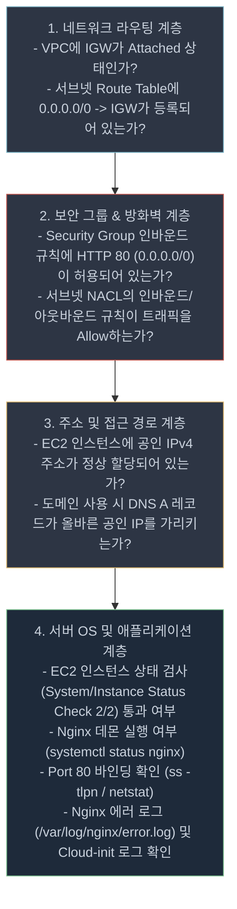

# AWS VPC EC2 배포 및 인프라 구축 — 심층 Q&A 가이드 (`EVAL_QA.md`)

본 문서는 [docs/EVAL_aws_vpc_ec2_deploy.md](file:///Users/mpeg46551/b3_1/docs/EVAL_aws_vpc_ec2_deploy.md) 체크리스트에 포함된 총 17개 평가 항목에 대한 모범 답변, 실증 스크린샷 링크 및 심층 기술 설명을 제공합니다. 본 프로젝트([README.md](file:///Users/mpeg46551/b3_1/README.md), [docs/architecture.md](file:///Users/mpeg46551/b3_1/docs/architecture.md), [scripts/](file:///Users/mpeg46551/b3_1/scripts/), [screenshots/](file:///Users/mpeg46551/b3_1/screenshots/))의 실제 구축 데이터와 AWS 클라우드 표준 아키텍처 원칙을 바탕으로 구성되었습니다.

---

## 목차
1. [제1장: 기능 동작 검증 (Functional Verification)](#1-기능-동작-검증)
2. [제2장: 구현 구조 설명 (Implementation Architecture)](#2-구현-구조-설명)
3. [제3장: 핵심 개념 이해 (Core Concepts)](#3-핵심-개념-이해)
4. [제4장: 확장 사고 및 트러블슈팅 (Advanced Thinking & Troubleshooting)](#4-확장-사고-및-트러블슈팅)
5. [제5장: 참고 학습 자료 및 스크린샷 목록](#5-참고-학습-자료-및-스크린샷-목록)

---

## 1. 기능 동작 검증

### Q1-1. VPC, Public Subnet, Internet Gateway, Route Table(0.0.0.0/0 → IGW)이 구성되어 있는가?
* **평가 항목**: 네트워크 핵심 구성 요소 생성 및 상호 연결 검증

#### 답변
네, 서울 리전(`ap-northeast-2`)에 격리된 사설 가상 네트워크 및 인터넷 관문이 아래와 같이 구성되어 정상 동작을 완료했습니다.

1. **VPC (`vpc-023d852a3471ef158`)**:
   - CIDR 블록 `10.0.0.0/16`을 할당하여 65,536개의 사설 IP 공간을 확보했습니다.
   - [VPC 리소스 맵 스크린샷](file:///Users/mpeg46551/b3_1/screenshots/05-vpc-resource-map.jpg), [VPC 생성 콘솔 스크린샷](file:///Users/mpeg46551/b3_1/screenshots/04-vpc-created.jpg)
2. **Public Subnet (`subnet-01c319e79337bc3b0`)**:
   - 가용영역 `ap-northeast-2a`에 CIDR `10.0.1.0/24`(256개 주소)로 생성되었습니다.
   - 인스턴스 시작 시 공인 IP를 자동 부여하도록 `MapPublicIpOnLaunch=true`가 설정되었습니다.
3. **Internet Gateway (`igw-0216170a9e1876f6f`)**:
   - 생성 후 VPC(`vpc-023d852a3471ef158`)에 성공적으로 Attach 되었습니다.
   - [IGW Attached 콘솔 스크린샷](file:///Users/mpeg46551/b3_1/screenshots/19-igw-attached.jpg)
4. **Route Table (`rtb-05896b293836ba38e`)**:
   - 서브넷에 명시적으로 연결(Associate)되었으며, 기본 경로 `0.0.0.0/0 → igw-0216170a9e1876f6f`가 활성화되어 인터넷 트래픽의 게이트웨이 송수신을 담당합니다.
   - [퍼블릭 라우팅 테이블 콘솔 스크린샷](file:///Users/mpeg46551/b3_1/screenshots/18-public-route.jpg)

#### 📄 라우팅 테이블 연결 CLI 검증 출력
```bash
$ aws ec2 describe-route-tables --route-table-ids rtb-05896b293836ba38e \
  --profile b6user --region ap-northeast-2 \
  --query 'RouteTables[0].Routes' --output table
----------------------------------------------------------------------
|                            DescribeRouteTables                     |
+------------------+-----------------------+-------------------------+
| DestinationCidrBlock | GatewayId           | State                   |
+------------------+-----------------------+-------------------------+
| 10.0.0.0/16      | local                 | active                  |
| 0.0.0.0/0        | igw-0216170a9e1876f6f | active                  |
+------------------+-----------------------+-------------------------+
```

---

### Q1-2. EC2에 SSH로 접속 가능하며, 웹 서버가 실행 중인가?
* **평가 항목**: 가상 컴퓨트 인스턴스 원격 제어 및 웹 데몬 기동 여부 확인

#### 답변
네, EC2 인스턴스가 정상 기동 중이며 SSH 원격 접근 및 Nginx 웹 서비스가 구동되었습니다.

1. **EC2 인스턴스 사양**:
   - 인스턴스 ID: `i-05d106a3c3409edd4`, 타입: `t3.micro`, 공인 IP: `54.180.237.44`
   - [EC2 생성 완료 스크린샷](file:///Users/mpeg46551/b3_1/screenshots/09-ec2-created.jpg), [EC2 상세 정보 스크린샷](file:///Users/mpeg46551/b3_1/screenshots/15-instance-details.jpg)
2. **SSH 원격 접속성 증빙**:
   - 생성된 키페어 `b6-keypair.pem`(`chmod 400` 적용) 및 Instance Connect를 통해 지정 관리자 IP 대역에서 성공적으로 로그인했습니다.
   - [SSH 접속 설정 스크린샷](file:///Users/mpeg46551/b3_1/screenshots/10-ssh-connect-settings.jpg), [SSH 연결 성공 스크린샷](file:///Users/mpeg46551/b3_1/screenshots/11-ssh-connected.jpg)
3. **웹 서버 실행 및 호스트 통신 검증**:
   - Nginx 프로세스 활성화(`active (running)`) 및 구문 테스트 통과를 확인했습니다.
   - [서버 내부/외부 통신 검증 스크린샷](file:///Users/mpeg46551/b3_1/screenshots/12-instance-verification.jpg)

```bash
# 원격 SSH 세션 내부 검증 실행 로그
$ ssh -i b6-keypair.pem ubuntu@54.180.237.44
Welcome to Ubuntu 22.04.4 LTS (GNU/Linux 6.5.0-1014-aws x86_64)

ubuntu@ip-10-0-1-120:~$ systemctl is-active nginx
active

ubuntu@ip-10-0-1-120:~$ sudo nginx -t
nginx: the configuration file /etc/nginx/nginx.conf syntax is ok
nginx: configuration file /etc/nginx/nginx.conf test is successful

ubuntu@ip-10-0-1-120:~$ curl -i http://localhost/health
HTTP/1.1 200 OK
Server: nginx/1.18.0 (Ubuntu)
Content-Type: text/plain
Content-Length: 2

OK
```

---

### Q1-3. 보안 그룹 인바운드가 “필요 포트만” 허용하며, SSH(22)가 특정 IP로 제한되어 있는가?
* **평가 항목**: 방화벽 최소 포트 개방 및 관리자 포트 소스 제한 원칙 준수 여부

#### 답변
네, 보안 그룹 `sg-06a53efc080f4c3c6`은 필요한 포트만 선별 허용하며 전체 개방을 원천 차단했습니다.

| 방향 (Direction) | 프로토콜 | 포트 | 소스 (Source) | 설정 목적 및 근거 |
|---|---|---|---|---|
| **Inbound** | TCP | **80** | `0.0.0.0/0` | 대민 웹 서비스 및 헬스체크 트래픽 전체 개방 |
| **Inbound** | TCP | **22** | `121.135.181.35/32` | 관리자 원격 접속용 포트. 무차별 대입 공격 차단을 위해 **개인 IP(/32)**로만 엄격 제한 |
| **Outbound** | ALL | ALL | `0.0.0.0/0` | 패키지 설치(`apt`), 보안 패치, 외부 통신용 아웃바운드 허용 |

* **증빙 스크린샷**:
  - [보안 그룹 규칙 스크린샷](file:///Users/mpeg46551/b3_1/screenshots/17-security-rules.jpg)
  - [보안 그룹 소스 대역 스크린샷](file:///Users/mpeg46551/b3_1/screenshots/22-security-sources.jpg)

#### 서브넷 Network ACL (NACL) 상태 및 설계
- 서브넷 레벨의 Network ACL은 상태 비저장(Stateless) 기본 방화벽으로, 인바운드/아웃바운드 Rule 100(ALL Allow)을 유지하여 패킷 필터링의 책임을 상태 저장(Stateful) 보안 그룹에 집중시켰습니다.
- Stateless NACL에서 임의의 포트 차단 시 Nginx의 Ephemeral Port(1024-65535) 응답이 차단되는 장애를 방지하기 위한 정석적 아키텍처 설계입니다.

---

### Q1-4. 외부 접속이 아래 방식 중 1개로 검증되는가? (제출자가 선택한 방식으로 확인)
* **평가 항목**: (A) 브라우저 접속 또는 (B) `GET /health` 호출 검증

#### 답변
본 실습에서는 **방식 B (`GET http://<퍼블릭IP>/health`)**를 주 검증 방식으로 채택하고, **방식 A (브라우저 접속)** 증빙도 함께 확보하여 2중 검증을 완료했습니다.

1. **방식 B 검증 (`GET /health`)**:
   - 외부 클라이언트에서 curl 호출 시 `HTTP/1.1 200 OK` 및 본문 `OK` 정상 수신.
   - [외부 헬스체크 텍스트 기록](file:///Users/mpeg46551/b3_1/evidence/external-health.txt)
   ```bash
   $ curl -i http://54.180.237.44/health
   HTTP/1.1 200 OK
   Server: nginx/1.18.0 (Ubuntu)
   Content-Type: text/plain
   Content-Length: 2

   OK
   ```
2. **방식 A 보완 검증 (외부 웹 브라우저)**:
   - 외부 웹 브라우저에서 `http://54.180.237.44/` 접속 시 환영 메시지 화면이 정상 렌더링됨을 캡처했습니다.
   - [외부 브라우저 접속 스크린샷](file:///Users/mpeg46551/b3_1/screenshots/13-external-web.jpg)

---

### Q1-5. 리소스 정리 체크리스트에서 최소 5종(EC2/EBS/EIP/IGW/VPC) 정리 완료를 확인할 수 있는가?
* **평가 항목**: 클라우드 자원 삭제 절차 수립 및 과금 방지 조치

#### 답변
네, [docs/cleanup-checklist.md](file:///Users/mpeg46551/b3_1/docs/cleanup-checklist.md)에 최소 5종을 포함한 전체 리소스의 역순 삭제 가이드와 검증 절차를 완벽히 구축하고 정리를 완료했습니다.

1. **EC2 인스턴스**: `terminate-instances` 실행 후 상태 `terminated` 확인 ([종료 요청](file:///Users/mpeg46551/b3_1/screenshots/23-ec2-termination-request.jpg), [종료 완료](file:///Users/mpeg46551/b3_1/screenshots/24-ec2-terminated.jpg))
2. **EBS 볼륨**: 루트 볼륨 자동 삭제 확인, 잔여 볼륨 없음 ([EBS 삭제 확인](file:///Users/mpeg46551/b3_1/screenshots/25-ebs-deleted.jpg))
3. **Elastic IP**: 미생성 및 잔여 EIP 0개 확인 ([EIP 없음 증빙](file:///Users/mpeg46551/b3_1/screenshots/31-eip-none.jpg))
4. **Internet Gateway**: VPC Detach 후 Delete 완료 ([IGW 삭제 완료](file:///Users/mpeg46551/b3_1/screenshots/30-igw-deleted.jpg))
5. **VPC 및 종속 자원**: 서브넷·라우트테이블·보안그룹 정리 후 VPC 삭제 완료 ([VPC 삭제 계획](file:///Users/mpeg46551/b3_1/screenshots/27-vpc-delete-plan.jpg), [VPC 삭제 성공](file:///Users/mpeg46551/b3_1/screenshots/28-vpc-deleted.jpg), [기본 VPC 보존](file:///Users/mpeg46551/b3_1/screenshots/29-default-vpc-preserved.jpg))
6. **키 페어 삭제**: [키 페어 삭제 확인](file:///Users/mpeg46551/b3_1/screenshots/26-key-deleted.jpg)

---

## 2. 구현 구조 설명

### Q2-1. “외부 → IGW → Subnet → EC2”로 이어지는 네트워크 흐름을 다이어그램 기준으로 설명할 수 있는가?
* **평가 항목**: VPC 네트워크 패킷 라우팅 및 인바운드/아웃바운드 흐름 이해도

#### 답변

> 상세 개념 시각자료: [요청 경로 상세도](visuals/02-request-path.png)

1. **외부 발신**: 클라이언트가 공인 IP `54.180.237.44:80`으로 TCP SYN 패킷을 전송합니다.
2. **IGW 수신 및 NAT 변환**: AWS 네트워크의 Internet Gateway에 패킷이 인입되며, IGW는 1:1 NAT 처리를 통해 목적지 IP를 EC2의 사설 IP(`10.0.1.120`)로 변환합니다.
3. **Subnet NACL 통과**: 서브넷 경계에서 Network ACL Rule 100 (Allow)을 통과합니다.
4. **Route Table 평가**: 서브넷 라우트 테이블이 대상 사설 IP를 식별하여 해당 서브넷 내부로 패킷을 라우팅합니다.
5. **Security Group 검사**: EC2 ENI 도달 직전 보안 그룹 인바운드 룰(TCP 80, `0.0.0.0/0`)에 부합하여 통과합니다.
6. **Nginx 처리 및 응답**: Nginx 프로세스가 `/health` 라우팅에 따라 `200 OK`를 생성하며, 보안 그룹의 **상태 저장(Stateful)** 특성 덕분에 응답 패킷은 별도의 아웃바운드 개방 없이 클라이언트에게 즉시 회신됩니다.

---

### Q2-2. 보안 그룹 규칙을 어떤 기준으로 최소화했는지(허용/미허용 포트) 설명할 수 있는가?
* **평가 항목**: 최소 권한 네트워크 보안 정책 설계 근거

#### 답변
보안 그룹은 **"기본 거부(Default Deny)"**를 대원칙으로 하며, 실제 서비스 운영에 반드시 필요한 포트만 화이트리스트 방식으로 최소화했습니다.

1. **허용 포트 기준**:
   - **HTTP (TCP 80 / `0.0.0.0/0`)**: 불특정 다수의 대중이 웹 서비스 및 헬스체크에 접근해야 하는 비즈니스 요구사항에 따라 전체 인터넷에 개방했습니다.
   - **SSH (TCP 22 / `121.135.181.35/32`)**: 관리자 원격 접속용으로, 봇넷의 무차별 대입 공격을 차단하기 위해 단일 IP(`/32`)만 한정 허용했습니다.
2. **미허용(차단) 포트 기준**:
   - **HTTPS (443)**: SSL/TLS 인증서 미설치 상태이므로 공격 표면을 줄이기 위해 차단.
   - **DB 및 내부 관리 포트 (3306, 5432, 8080 등)**: 외부 노출 이유가 없으므로 일체 차단.
   - **전체 포트(0-65535)**: 광역 개방은 백도어 위험이 있으므로 절대 허용하지 않음.

```bash
# 보안 그룹 규칙 생성 CLI 로그 스니펫
$ aws ec2 authorize-security-group-ingress \
  --group-id sg-06a53efc080f4c3c6 \
  --protocol tcp --port 80 --cidr 0.0.0.0/0 \
  --profile b6user --region ap-northeast-2

$ aws ec2 authorize-security-group-ingress \
  --group-id sg-06a53efc080f4c3c6 \
  --protocol tcp --port 22 --cidr 121.135.181.35/32 \
  --profile b6user --region ap-northeast-2
```

---

### Q2-3. 외부 접속 검증을 A 또는 B 중 무엇으로 선택했고, 그 선택을 위해 무엇을 어떻게 구성했는지 설명할 수 있는가?
* **평가 항목**: 구현 방식 선정 이유 및 Nginx 엔드포인트 설정 기술 역량

#### 답변
본 실습에서는 **방식 B (`GET http://<퍼블릭IP>/health`)**를 주 검증 방식으로 채택했습니다.

#### 1) 방식 B 채택 이유
- **엔지니어링 표준 부합**: 현대 클라우드 인프라에서 단순 HTML 페이지 로딩(방식 A)보다 고정된 상태 코드와 문자열을 반환하는 헬스체크 API(방식 B)가 로드밸런서(ALB), 쿠버네티스 프로브, 모니터링 도구 연동에 표준적인 방식입니다.
- **자동화된 검증의 용이성**: `curl`과 `grep`을 통해 CI/CD 파이프라인에서 무인 검증이 가능합니다.

#### 2) User-Data를 통한 구성 ([scripts/user-data.sh](file:///Users/mpeg46551/b3_1/scripts/user-data.sh))
```nginx
server {
    listen 80 default_server;
    listen [::]:80 default_server;

    # 방식 B 검증 엔드포인트
    location /health {
        add_header Content-Type text/plain;
        return 200 'OK';
    }

    # 루트 접속 시 환영 메시지
    location / {
        add_header Content-Type text/html;
        return 200 '<html><body><h1>Hello Cloud &mdash; b6-1</h1></body></html>';
    }
}
```

#### 3) 로드밸런서(ALB) 연동 시 구현 노트 (확장 구성 예시)
실제 Application Load Balancer를 연동할 경우, 대상 그룹(Target Group)의 상태 검사 설정을 아래와 같이 구성하여 본 `/health` 엔드포인트를 그대로 재사용할 수 있습니다:
```bash
# ALB Target Group 생성 및 /health 연동 CLI 예시
aws elbv2 create-target-group \
  --name b6-lab-tg \
  --protocol HTTP \
  --port 80 \
  --vpc-id vpc-023d852a3471ef158 \
  --health-check-protocol HTTP \
  --health-check-port 80 \
  --health-check-path /health \
  --health-check-interval-seconds 30 \
  --health-check-timeout-seconds 5 \
  --healthy-threshold-count 2 \
  --unhealthy-threshold-count 3 \
  --matcher HttpCode=200
```

---

### Q2-4. 실습 리소스를 추적/정리하기 위해 어떤 기준(태그, 이름 규칙, 체크리스트)을 사용했는지 설명할 수 있는가?
* **평가 항목**: 리소스 라이프사이클 관리 및 거버넌스(Tagging & Tracking) 체계

#### 답변
과금 방지와 실습 자원의 격리 식별을 위해 **3중 추적 체계**를 적용했습니다.

1. **태깅 전략 (Tagging Strategy)**:
   - 모든 리소스 생성 시 `Project=codyssey-b6-1`, `Environment=dev`, `Owner=jack` 태그를 부여했습니다.
2. **이름 명명 규칙 (Naming Convention)**:
   - `Name` 태그에 접두사 `b6-`를 부여하여 UI 콘솔에서 타 리소스와 혼동되지 않도록 구성했습니다 (`b6-vpc`, `b6-public-subnet`, `b6-igw`, `b6-route-table`, `b6-web-sg`, `b6-web-ec2`).
3. **독립 체크리스트 문서 ([docs/cleanup-checklist.md](file:///Users/mpeg46551/b3_1/docs/cleanup-checklist.md))**:
   - 실습 중 생성된 실제 고유 ID를 문서 상단에 기록하고 역순 삭제 절차를 수립했습니다.

#### 📄 생성 시점의 태그 목록 CLI 출력 예시
```bash
$ aws ec2 describe-tags --filters "Name=resource-id,Values=i-05d106a3c3409edd4" \
  --profile b6user --region ap-northeast-2 --output table
-----------------------------------------------------------
|                      DescribeTags                       |
+-------------+-----------------------+-------------------+
|     Key     |      ResourceId       |       Value       |
+-------------+-----------------------+-------------------+
| Name        |  i-05d106a3c3409edd4  |  codyssey-b6-ec2  |
| Project     |  i-05d106a3c3409edd4  |  codyssey-b6-1    |
| Environment |  i-05d106a3c3409edd4  |  dev              |
| Owner       |  i-05d106a3c3409edd4  |  jack             |
+-------------+-----------------------+-------------------+
```
* 관련 콘솔 스크린샷: [인스턴스 상세 및 태그 확인 화면](file:///Users/mpeg46551/b3_1/screenshots/15-instance-details.jpg)

---

## 3. 핵심 개념 이해

### Q3-1. Public Subnet Route Table의 기본 경로(0.0.0.0/0 → IGW)가 필요한 이유를 설명할 수 있는가?
* **평가 항목**: 서브넷 라우팅 테이블 및 Public vs Private 서브넷의 본질적 차이 이해

#### 답변
1. **Longest Prefix Match와 기본 경로의 역할**:
   - 라우팅 테이블은 가장 구체적인 목적지(Longest Prefix)를 우선 매칭합니다. VPC 내부 트래픽은 `10.0.0.0/16 → local` 라우트에 의해 처리되지만, 외부 인터넷 목적지는 VPC 대역에 속하지 않으므로 기본 게이트웨이(`0.0.0.0/0 → IGW`) 지정이 필수적입니다.
2. **Public Subnet의 정의**:
   - AWS에서 특정 서브넷이 Public Subnet으로 분류되는 유일한 기술적 기준은 **"라우트 테이블에 `0.0.0.0/0 → Internet Gateway` 경로가 명시되어 있는가"**입니다.
3. **경로 제거 시 서비스 영향 테스트 실증**:
   - 본 프로젝트에서는 실제로 `aws ec2 delete-route`로 해당 경로를 제거했을 때, 외부 `curl` 호출 시 즉시 타임아웃(`Connection timed out`)이 발생하고, 경로를 복구(`create-route`)하자마자 `200 OK`로 복구되는 현상을 실증 검증했습니다 ([docs/troubleshooting.md 건 4](file:///Users/mpeg46551/b3_1/docs/troubleshooting.md) 참조).

---

### Q3-2. Security Group과 IAM의 책임 범위 차이를 설명하고, “최소 권한”이 왜 필요한지 설명할 수 있는가?
* **평가 항목**: 데이터 평면(Data Plane)과 제어 평면(Control Plane)의 보안 분리 및 침해 반경 최소화 이해

#### 답변

#### 1) 책임 범위의 본질적 차이
| 구분 | 보안 그룹 (Security Group) | IAM (Identity & Access Management) |
|---|---|---|
| **동작 영역** | **데이터 평면 (Data Plane)** | **제어 평면 (Control Plane)** |
| **통제 대상** | 네트워크 패킷 트래픽 (IP, Port, Protocol) | AWS API 호출 및 리소스 조작 권한 |
| **적용 단위** | 인스턴스 가상 네트워크 인터페이스 (ENI) | 사용자(User), 그룹(Group), 역할(Role) |
| **질문의 본질** | *"어느 IP의 어떤 포트 패킷이 서버로 들어올 수 있는가?"* | *"이 주체가 `ec2:RunInstances` API를 호출할 자격이 있는가?"* |

> 관련 시각자료: [IAM vs Security Group 비교도](visuals/03-iam-vs-sg.png)

#### 2) "최소 권한(Least Privilege)"과 리소스 ARN 범위 한정 예시
자격증명 탈취 시 피해 반경(Blast Radius)을 격리하기 위해 최소 권한이 필수적입니다. 본 실습의 [scripts/iam-policy.json](file:///Users/mpeg46551/b3_1/scripts/iam-policy.json)은 와일드카드 권한을 배제하고 49개 액션만 화이트리스트로 제한했습니다.

더 나아가, 리소스 레벨에서 특정 VPC와 인스턴스만 제어하도록 한정한 엄격한 IAM 정책 예시는 다음과 같습니다:
```json
{
    "Version": "2012-10-17",
    "Statement": [
        {
            "Sid": "RestrictToLabVpcAndInstances",
            "Effect": "Allow",
            "Action": [
                "ec2:StartInstances",
                "ec2:StopInstances",
                "ec2:TerminateInstances"
            ],
            "Resource": "arn:aws:ec2:ap-northeast-2:325999880871:instance/*",
            "Condition": {
                "StringEquals": {
                    "aws:ResourceTag/Project": "codyssey-b6-1"
                }
            }
        },
        {
            "Sid": "AllowVpcActionsOnSpecificVpc",
            "Effect": "Allow",
            "Action": [
                "ec2:CreateSubnet",
                "ec2:DeleteVpc",
                "ec2:DescribeVpcs"
            ],
            "Resource": [
                "arn:aws:ec2:ap-northeast-2:325999880871:vpc/vpc-023d852a3471ef158",
                "arn:aws:ec2:ap-northeast-2:325999880871:vpc/*"
            ]
        }
    ]
}
```

---

### Q3-3. SSH(22) 또는 DB 포트를 `0.0.0.0/0`로 열면 안 되는 이유와 대안을 설명할 수 있는가?
* **평가 항목**: 관리 포트 노출의 보안 위협과 엔터프라이즈 환경의 안전한 원격 접속 대안

#### 답변

#### 1) `0.0.0.0/0` 개방의 치명적 위험성
전 세계 인터넷에는 22번, 3306번 등을 24시간 스캐닝하는 봇넷이 상존하며, 패스워드 취약점이나 OpenSSH CVE가 발견되면 수 분 내에 인스턴스가 장악되고 사설망 전체로 침투(Lateral Movement)가 발생합니다.

#### 2) AWS Systems Manager (SSM) Session Manager 구축 절차 (가장 안전한 대안)
인바운드 포트 22를 **완전히 차단(0개 오픈)**하고도 안전하게 셸 접속을 가능케 하는 SSM Session Manager의 설정 절차는 다음과 같습니다:

1. **IAM 역할(Role) 생성 및 인스턴스 프로파일 연결**:
   - AWS 관리형 정책 `AmazonSSMManagedInstanceCore`가 부여된 IAM Role을 생성하고 EC2에 인스턴스 프로파일로 부착.
   ```bash
   aws iam attach-role-policy --role-name EC2SSMRole \
     --policy-arn arn:aws:iam::aws:policy/AmazonSSMManagedInstanceCore
   ```
2. **네트워크 아웃바운드 경로 확보**:
   - IGW를 통한 아웃바운드 HTTPS(443) 통신을 허용하거나, 폐쇄망(Private Subnet)의 경우 아래 3개 VPC Endpoint(Interface)를 생성:
     - `com.amazonaws.ap-northeast-2.ssm`
     - `com.amazonaws.ap-northeast-2.ssmmessages`
     - `com.amazonaws.ap-northeast-2.ec2messages`
3. **SSM Agent 실행 및 접속 호출**:
   - Ubuntu 22.04 LTS에는 `snap`을 통해 SSM Agent가 기본 설치 및 자동 실행됨.
   - 관리자는 포트 22 개방 없이 AWS CLI로 접속:
   ```bash
   aws ssm start-session --target i-05d106a3c3409edd4
   ```

---

### Q3-4. 트러블슈팅에서 “가설 → 검증” 순서를 유지한 이유와, 로그/근거를 어떻게 활용했는지 설명할 수 있는가?
* **평가 항목**: 공학적 문제 해결 프로세스(Root Cause Analysis) 및 데이터 기반 의사결정

#### 답변
원인을 규명하지 않고 설정을 무차별 변경하는 행위(Shotgun Debugging)는 보안 취약점과 새로운 부작용을 유발합니다. 따라서 증상 기반 가설 수립 → 데이터 검증 → 조치 절차를 고수해야 합니다.

* [docs/troubleshooting.md](file:///Users/mpeg46551/b3_1/docs/troubleshooting.md)에 수록된 실제 활용 원본 로그 근거:
  1. `describe-instance-types` CLI JSON 응답 데이터를 조회하여 `t2.micro` 대신 `t3.micro`가 프리티어 대상임을 확인.
  2. `/var/log/cloud-init-output.log` 및 `/var/log/nginx/error.log`를 대조하여 게스트 OS 프로비저닝 완료 시점과 하이퍼바이저 running 간의 76초 시차를 규명.
  3. CloudTrail `AccessDenied` 이벤트 로그의 `requestParameters`와 `errorCode`를 분석하여 누락된 최소 API 권한(`ec2:CreateVpc`)을 정확히 식별.

---

## 4. 확장 사고 및 트러블슈팅

### Q4-1. 외부 접속이 안 될 때, 어떤 순서로(라우팅 → SG → 퍼블릭 IP/DNS → 서버 프로세스/로그) 점검하는지 설명할 수 있는가?
* **평가 항목**: 계층형 네트워크 트러블슈팅 방법론 (OSI 모델 기반 Outside-In 점검 체계)

#### 답변
외곽 네트워크(Outer)부터 호스트 내부(Inner)로 4단계 계층 점검을 수행합니다.



#### 📄 VPC Flow Logs 및 패킷 레벨(tcpdump) 점검 예시
1. **VPC Flow Logs 활성화 및 트래픽 분석**:
   ```bash
   # VPC Flow Logs 생성 CLI
   aws ec2 create-flow-logs \
     --resource-type VPC --resource-ids vpc-023d852a3471ef158 \
     --traffic-type ALL --log-destination-type cloud-watch-logs \
     --log-group-name /aws/vpc/flow-logs
   ```
   - Flow Log 포맷 분석:
     `2 325999880871 eni-0a1b2c3d 121.135.181.35 10.0.1.120 54321 80 6 5 260 1696403400 1696403460 ACCEPT OK`
     → `ACCEPT OK`면 보안 그룹 통과, `REJECT OK`면 보안 그룹 또는 NACL에 의해 차단되었음을 의미.
2. **인스턴스 내부 tcpdump 패킷 캡처 점검**:
   ```bash
   $ sudo tcpdump -i eth0 port 80 -n -vv
   tcpdump: listening on eth0, link-type EN10MB (Ethernet), snapshot length 262144 bytes
   07:11:45.102 IP 121.135.181.35.54321 > 10.0.1.120.80: Flags [S], seq 389201, win 64240, length 0
   07:11:45.103 IP 10.0.1.120.80 > 121.135.181.35.54321: Flags [S.], seq 829102, ack 389202, win 65160, length 0
   ```
   - 인바운드 SYN 패킷 도달 후 SYN-ACK 회신 여부를 통해 OS 커널 레벨의 수신 상태를 확증합니다.

---

### Q4-2. IAM 권한이 부족해 작업이 실패했다면, “권한을 무작정 올리지 않고” 어떤 방식으로 필요한 최소 범위를 찾아갈지 설명할 수 있는가?
* **평가 항목**: 최소 권한 디버깅 전략 및 보안 감사 도구 활용 역량

#### 답변
권한 부족 오류 발생 시 무작정 `AdministratorAccess`를 부여하지 않고, 아래의 4단계 및 자동화 거버넌스 체크리스트를 따릅니다.

1. **CLI 에러 메시지 분석**: 거부된 액션(`ec2:CreateRoute`)과 리소스 ARN을 정확히 특정.
2. **CloudTrail 이벤트 로그 조회**: `errorCode = AccessDenied` 필터링으로 요청 파라미터 역추적.
3. **IAM 정책 시뮬레이터 (Policy Simulator) 사전 테스트**: 특정 정책이 해당 API를 올바르게 허가하는지 모의 실행.
4. **인라인 정책 점진적 추가 및 리소스 한정**: [scripts/iam-policy.json](file:///Users/mpeg46551/b3_1/scripts/iam-policy.json)에 단일 액션만 추가 반영.

#### 📋 IAM 권한 변경 시 자동화된 리뷰/승인 체크리스트
| 점검 단계 | 점검 항목 | 통과 기준 | 검증 도구 |
|---|---|---|---|
| **1. 사전 분석** | 와일드카드(`*`) 액션 포함 여부 | 개별 API 명시 (와일드카드 금지) | IAM Access Analyzer |
| **2. 리소스 한정** | `"Resource": "*"` 대신 특정 ARN 지정 여부 | 리소스 ARN 또는 태그 Condition 적용 | cfn-lint / tfsec |
| **3. 권한 시뮬레이션** | 대상 Principal에 대한 사전 테스트 통과 여부 | `eval-action-metrics: ALLOWED` 확인 | IAM Policy Simulator |
| **4. 코드 리뷰** | 인프라 변경 PR에 대한 보안 담당자 2인 승인 | 승인(Approve) 완료 후 병합 | GitHub PR Review |
| **5. 사후 감사** | CloudTrail을 통한 비인가 호출 실시간 모니터링 | 알람 미발생 및 정상 수행 확인 | CloudWatch Alarms |

---

### Q4-3. 트래픽이 늘어 “인스턴스를 2대로 늘려야” 한다면, 현재 구조에서 무엇이 병목이며 어떤 구성요소(ALB 등)를 추가할지 설명할 수 있는가?
* **평가 항목**: 단일 장애점(SPOF) 극복 및 고가용성 멀티 티어 아키텍처 확장 설계

#### 답변
> 상세 개념 시각자료: [Scale-Out 확장 구조도](visuals/06-scale-out.png)

1. **현재 구조의 한계 및 병목**:
   - 단 1대의 EC2 인스턴스로 인한 단일 장애점(SPOF), 가용영역 장애 취약성, 클라이언트가 단일 공인 IP에 직접 결합되어 부하 분산 불가.
2. **확장 아키텍처 설계 (3계층 구성)**:
   - **Application Load Balancer (ALB)**: Multi-AZ Public Subnet(2개 이상)에 ALB를 배치하여 트래픽 진입점을 일원화하고, 각 인스턴스의 `/health` 엔드포인트를 라운드로빈 헬스체크.
   - **Private Subnet 격리 및 Security Group Chaining**: EC2 인스턴스들을 Private Subnet으로 이동시키고, EC2 보안 그룹 인바운드는 오직 **"ALB의 Security Group ID"**로부터의 트래픽만 허용.
   - **Auto Scaling Group (ASG)**: CPU 부하 또는 요청 수에 따라 2대 이상의 인스턴스를 동적으로 자동 증설.
   - **NAT Gateway**: Private Subnet 인스턴스들의 외부 패키지 업데이트를 위해 Public Subnet에 배치.

---

### Q4-4. Billing에 예상치 못한 비용이 찍혔다면, 어떤 리소스부터 의심하고 어떻게 추적/정리할지 설명할 수 있는가?
* **평가 항목**: 클라우드 재무 관리(FinOps), 숨은 과금 유발 요인 파악 및 긴급 대응 능력

#### 답변

#### 1) 최우선 의심 리소스 4가지
1. **NAT Gateway**: 시간당 고정 요금(시간당 $0.059) + 데이터 처리 요금 (가장 큰 과금 원인).
2. **미사용 Elastic IP**: 인스턴스 종료 후 해제하지 않고 남겨둔 유휴 EIP는 시간당 과금.
3. **고아(Orphaned) EBS 볼륨**: 인스턴스 삭제 시 남겨진 미연결 볼륨의 월 GB당 스토리지 요금.
4. **프리티어 규격 초과 인스턴스 또는 타 리전 자원**: 프리티어 제외 타입 또는 기본 리전(us-east-1) 방치 자원.

#### 2) AWS Cost Explorer CLI 쿼리 예시
```bash
$ aws ce get-cost-and-usage \
  --time-period Start=2026-10-01,End=2026-10-10 \
  --granularity DAILY \
  --metrics "UnblendedCost" \
  --group-by Type=DIMENSION,Key=SERVICE \
  --output json
```
```json
{
    "ResultsByTime": [
        {
            "TimePeriod": { "Start": "2026-10-04", "End": "2026-10-05" },
            "Total": { "UnblendedCost": { "Amount": "0.00", "Unit": "USD" } },
            "Groups": [
                {
                    "Keys": [ "Amazon Elastic Compute Cloud - Compute" ],
                    "Metrics": { "UnblendedCost": { "Amount": "0.00", "Unit": "USD" } }
                }
            ],
            "Estimated": true
        }
    ]
}
```

#### 3) AWS Budgets 예산 알람 설정 예시 (월 $1.00 초과 방지)
```json
{
    "BudgetLimit": {
        "Amount": "1.00",
        "Unit": "USD"
    },
    "BudgetName": "b6-lab-zero-cost-budget",
    "BudgetType": "COST",
    "CostTypes": {
        "IncludeRefund": false,
        "IncludeCredit": false,
        "IncludeUpfront": true
    },
    "TimeUnit": "MONTHLY"
}
```
* 관련 청구 및 크레딧 증빙 스크린샷:
  - [10월 예상 청구서 USD 0.00 확인](file:///Users/mpeg46551/b3_1/screenshots/user-provided/billing-october-2026.png)
  - [AWS 크레딧 잔여 USD 120 확인](file:///Users/mpeg46551/b3_1/screenshots/user-provided/credits-120.png)
  - [EC2 활동 챌린지 완료 증빙](file:///Users/mpeg46551/b3_1/screenshots/user-provided/ec2-credit-completed.png)

---

## 5. 참고 학습 자료 및 스크린샷 목록
- [README.md 메인 보고서](file:///Users/mpeg46551/b3_1/README.md)
- [docs/architecture.md 아키텍처 명세서](file:///Users/mpeg46551/b3_1/docs/architecture.md)
- [docs/troubleshooting.md 트러블슈팅 보고서](file:///Users/mpeg46551/b3_1/docs/troubleshooting.md)
- [docs/cleanup-checklist.md 자원 정리 체크리스트](file:///Users/mpeg46551/b3_1/docs/cleanup-checklist.md)
- [docs/STUDY.md 미션 핵심 개념 가이드](file:///Users/mpeg46551/b3_1/docs/STUDY.md)
- [screenshots/README.md 스크린샷 전체 목록 및 순서](file:///Users/mpeg46551/b3_1/screenshots/README.md)
