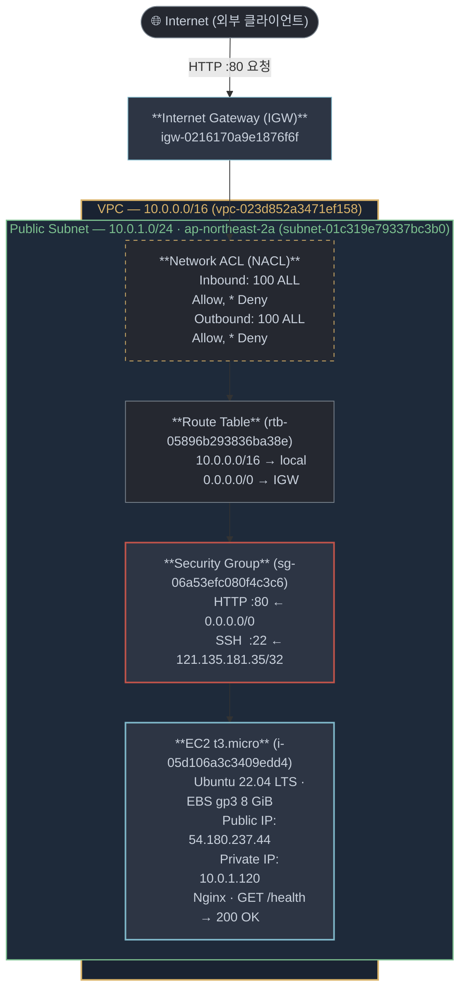
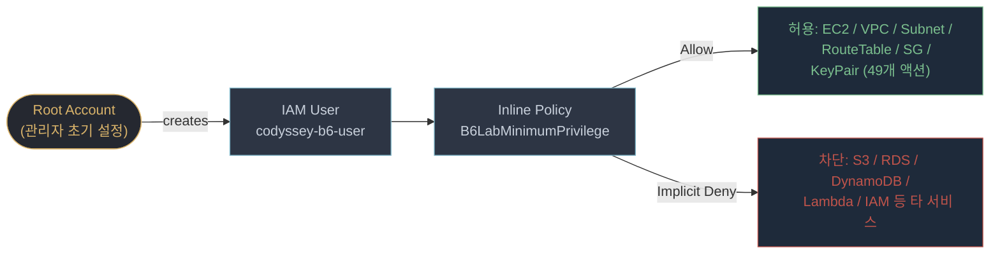
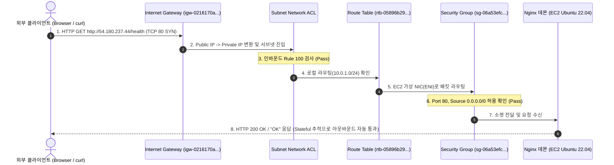

# 아키텍처 다이어그램 및 네트워크 설계 — b6-1

## 1. 아키텍처 개요 (PNG 다이어그램)

> **요구사항 충족**: 미션 요구서에 부합하는 PNG 형식의 아키텍처 이미지 파일을 저장소에 포함하고 링크합니다.


배포 당시 VPC, 퍼블릭 서브넷, Internet Gateway, 라우팅 테이블, 보안 그룹, EC2 인스턴스의 실제 토폴로지를 시각화한 구성도입니다.

---

## 2. 전체 인프라 구성도 (Mermaid)



* 관련 콘솔 스크린샷:
  - [VPC 리소스 맵](file:///Users/mpeg46551/b3_1/screenshots/05-vpc-resource-map.jpg)
  - [활성 인터넷 라우트(0.0.0.0/0 → IGW)](file:///Users/mpeg46551/b3_1/screenshots/18-public-route.jpg)
  - [IGW VPC 연결 상태(Attached)](file:///Users/mpeg46551/b3_1/screenshots/19-igw-attached.jpg)

---

## 3. 서브넷 Network ACL(NACL) 구성 및 보안 이력

### 1) NACL 기본 상태 및 역할
Network ACL은 서브넷 경계에서 동작하는 **상태 비저장(Stateless)** 패킷 필터링 방화벽입니다.
실습 VPC 생성 시 기본 생성된 NACL을 서브넷(`subnet-01c319e79337bc3b0`)에 연결하여 사용했습니다.

* **인바운드 규칙 (Inbound Rules)**:
  - `규칙 100`: ALL 트래픽, ALL 프로토콜, ALL 포트 범위, 소스 `0.0.0.0/0` → **ALLOW**
  - `규칙 *`: 기본 거부 (Default Deny)
* **아웃바운드 규칙 (Outbound Rules)**:
  - `규칙 100`: ALL 트래픽, ALL 프로토콜, ALL 포트 범위, 대상 `0.0.0.0/0` → **ALLOW**
  - `규칙 *`: 기본 거부 (Default Deny)

```bash
# 서브넷 NACL 설정 확인 CLI
aws ec2 describe-network-acls \
  --filters "Name=association.subnet-id,Values=subnet-01c319e79337bc3b0" \
  --query 'NetworkAcls[0].Entries[*].[RuleNumber,Protocol,RuleAction,Egress,CidrBlock]' \
  --output table
```

### 2) NACL 변경 이력 및 보안 설계 원칙
- **설계 의도**: 본 실습에서는 서브넷 레벨의 NACL은 기본 허용 상태(Rule 100 ALLOW)로 유지하고, 인스턴스 ENI 경계의 **상태 저장(Stateful) 보안 그룹(Security Group)**에서 HTTP(80) 공개 및 SSH(22) 단일 IP 제한을 통해 세부 제어를 수행했습니다.
- **이유**: NACL은 Stateless이므로 응답 트래픽에 대한 Ephemeral Port(1024~65535) 아웃바운드 규칙을 수동으로 열어주어야 하므로 관리 복잡도가 증가합니다. 침해 방어의 1차 방어선으로 보안 그룹의 최소 권한 화이트리스트를 집중 적용했습니다.

---

## 4. 보안 그룹 (Security Group) 최소화 규칙

* [실제 SG 규칙 스크린샷](file:///Users/mpeg46551/b3_1/screenshots/17-security-rules.jpg)
* [보안 소스 대역 스크린샷](file:///Users/mpeg46551/b3_1/screenshots/22-security-sources.jpg)

| 방향 | 프로토콜 | 포트 범위 | 소스 / 대상 | 목적 및 사유 |
|---|---|---|---|---|
| **Inbound** | TCP | 80 | `0.0.0.0/0` | 대민 웹 서비스 및 외부 헬스체크(`/health`) 트래픽 허용 |
| **Inbound** | TCP | 22 | `121.135.181.35/32` | 관리자 원격 접속 포트. 무차별 대입 공격 방지를 위해 단일 IP(/32)만 한정 허용 |
| **Outbound** | ALL | ALL | `0.0.0.0/0` | OS 패키지 설치(`apt`), 보안 업데이트, 외부 API 통신 지원 |

---

## 5. IAM 최소권한 구조



* 관련 개념 시각자료: [IAM vs Security Group 차이](visuals/03-iam-vs-sg.png)
* 관련 콘솔 스크린샷: [IAM 정책 조회 제한 증빙](file:///Users/mpeg46551/b3_1/screenshots/21-iam-read-denied.jpg)

---

## 6. 트래픽 흐름 및 처리 시퀀스



* 관련 개념 시각자료: [요청 및 응답 흐름 상세도](visuals/02-request-path.png)
